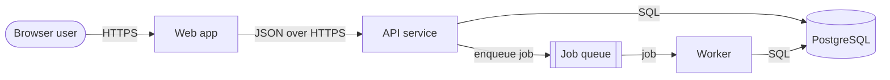
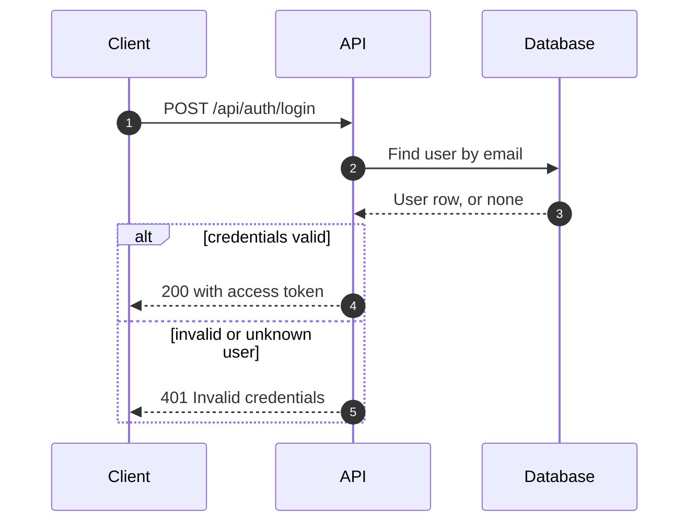
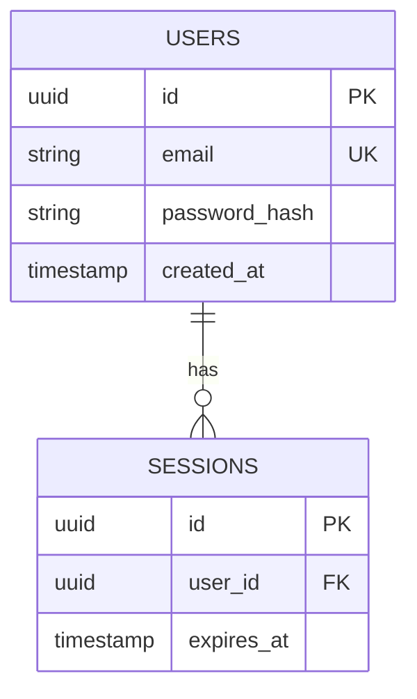

# Architecture Documentation

How to write and sync `docs/ARCHITECTURE.md`, `docs/DB.md` and `docs/DESIGN.md`, and how to draw diagrams as code with Mermaid; assumes the RelayCrew doc templates, GitHub-rendered Markdown and the Mermaid documentation (12.3.0 shown on its site), checked 2026-11-26. The Mermaid version your docs host renders may be older, so check it.

## Contents

- Ownership and status
- Principles for specification documents
- Writing ARCHITECTURE.md
- Writing DB.md
- Writing DESIGN.md
- Diagrams as code
- Syncing specs with what was built

## Guidance

### Ownership and status

The architect owns all three files. The implementer never edits them: when code changes a component, table or screen, the implementer names the file in `Docs impact` for the architect.

Each file opens with `Owner: architect. Status: draft`. The architect keeps the status as the template gives it. Only the user approves a specification, so no agent flips `Status` or marks requirements approved.

For topics another skill owns, write one routing line and stop:

- Decision records and their format: load `system-architecture`.
- Choosing a pattern or a scaling approach: load `system-architecture`.
- Schema design, index choice and migration technique: load `database-engineering`.
- UI and UX practice, accessibility technique: load `frontend-engineering`.
- Threat modelling: load `security-engineering`.
- PRD content: load `product-technical-planning`.

### Principles for specification documents

1. **Describe, with reasons where they matter.** Reference content (component tables, schema, tokens) is neutral and complete. Explanation content (why this design, what was rejected) sits in its own sections, not mixed into tables. See the Diátaxis types in [api-documentation.md](api-documentation.md).
2. **Derive from the source, not from memory.** Components from the directory layout and entry points, dependencies from the manifest and lockfile, deployment from container and pipeline files, schema from migrations or models, screens from routes and components. Read the actual files.
3. **State each fact once.** Link instead of copying: endpoints to `API-CONTRACTS.md`, tokens to the token file, decisions to `docs/adr/`.
4. **Make quality attributes measurable.** A target is a number and a condition, or it is marked **open**.
5. **Mark intent.** Design that exists only on paper carries `Planned (task: <slug>)`. Docs sync removes the mark when the work is built and verified. Docs describe what is true now.
6. **Mark confidence.** Assumptions are labelled. Unconfirmed claims are labelled **unverified**.
7. **Keep it readable.** A new colleague should be able to read `ARCHITECTURE.md` in about fifteen minutes. If a section grows past a screen of reference tables, keep the summary and link the detail.
8. **No secrets or internal addresses.** Name systems by role, not by private hostname or address.

### Writing ARCHITECTURE.md

Use the template's headings in order. For each section:

| Section | Answers | Write | Derive from |
|---|---|---|---|
| Context and boundaries | What is this system, who uses it, what is outside it? | Purpose, users, neighbouring systems, one context diagram | PRD summary, entry points, integrations |
| Quality attributes | How well must it work? | Targets such as latency, availability, capacity, with numbers and conditions, or **open** | PRD non-functional requirements |
| Components and responsibilities | What are the parts? | Table: component, responsibility, data it owns, what it talks to | Directory layout, entry points, compose or deployment files |
| Data and control flow | How does a request or event move? | Two to four key flows as sequence diagrams, each with its main failure path | Code of the key paths |
| External dependencies | What do we rely on that we do not own? | Table: name, purpose, version or tier, behaviour when unavailable, link to the decision | Manifest, lockfile, configuration |
| Security model and trust boundaries | Where does trust change? | Boundaries, where authentication and authorisation happen, where sensitive data is stored | Code of the entry points, `DB.md` |
| Deployment topology | Where does it run? | Environments, runtime, how components are placed | Container, pipeline and infrastructure files |
| Observability | How do we see it working? | What logs, metrics, traces and alerts exist now | Logging and metrics configuration |
| Risks and trade-offs | What could hurt, and what did we give up? | Named risks with mitigation, trade-offs in one line each | Task files, review findings |
| Related decisions | Why is it like this? | List of ADRs with a one-line outcome and a link | `docs/adr/` |

Judgement:

- A small project does not need all ten sections filled. Where a section does not apply, write one line saying why (for example "single process, no network boundary inside the system") rather than deleting the heading.
- A component table that mirrors the code layout is more useful than a long narrative. Keep names identical to the code.
- Deployment procedure (how to release or roll back) belongs to `devops-deployment`. Describe only the topology here.

### Writing DB.md

| Section | Write | Derive from |
|---|---|---|
| Engine and version | Database engine and the version the project runs, with where that version is set | Manifest, container image, CI |
| Entity model | A Mermaid ER diagram of the main entities and relationships | Migrations, models |
| Tables or collections | The template table: Name, Purpose, Key fields, Constraints | Migrations, models |
| Relationships | Cardinality, foreign keys, what happens on delete or update | Migrations, models |
| Indexes and the queries they serve | Each index paired with the query or endpoint that needs it | Migrations and the code's queries |
| Transactions and consistency | Which operations are transactional, isolation assumptions, how retries stay safe | Code of the write paths |
| Migrations and rollback | The tool, how to apply, the rollback step for each migration or the recovery plan | Migration files, project scripts |
| Retention, backup and sensitive data | Which columns hold personal or sensitive data, retention periods, backup schedule | PRD, operations configuration |

Rules specific to `DB.md`:

1. Compare the table list in the document with the schema source on every sync. Every table, column group and constraint in the source appears in the doc, and nothing in the doc is absent from the source.
2. Every migration entry states forward and rollback. "Re-deploy the old version" is not a rollback when the schema changed. Never describe editing an applied migration.
3. Migration commands in this file are verified commands but they change data. Do not run them against anything but a local or test database. Running migrations elsewhere needs user approval.
4. Sensitive data lists column names and categories, never real values.
5. For how to design the schema or choose indexes, load `database-engineering`.

### Writing DESIGN.md

| Section | Write |
|---|---|
| Design principles | Three to six principles the design follows, each with the reason |
| Information architecture | Navigation structure and how content is grouped, as a short list or a diagram |
| User flows | One flow per main task as a Mermaid flowchart, with the decision points and failure exits |
| Screens and states | A table of screens against states. The template requires loading, empty, error, success and permission-denied |
| Design tokens and components | Token names and their roles. Link to the token file for values. List shared components and their variants |
| Responsive behaviour | The breakpoints, what changes at each, with the source of the breakpoint values |
| Accessibility requirements | The conformance target the project chose and the checks that prove it, stated so each can be answered yes or no |
| Open questions | Numbered decisions awaiting the user |

For UI practice and accessibility technique, load `frontend-engineering`. For user-facing copy and visual design decisions that are the user's to make, list them under open questions.

### Diagrams as code

GitHub renders fenced blocks with the `mermaid` identifier in Markdown files, issues, pull requests, discussions and wikis. Keep diagrams as text next to the prose they explain.

**Choose the type:**

| Need | Mermaid type | Notes |
|---|---|---|
| System context, containers, components | `flowchart` with `subgraph` | Mermaid also has C4 keywords (`C4Context`, `C4Container`, `C4Component`), but their layout is not automatic and several features are unsupported, so a flowchart is usually clearer |
| Request or event flow over time | `sequenceDiagram` | Include the main failure branch |
| Data model | `erDiagram` | Mirrors `DB.md` |
| User flow | `flowchart` | Decision points as diamonds |
| State machine, timeline, other | see the supported list in the Mermaid documentation | Check syntax with context7 before use |

**Rules:**

1. One diagram answers one question. If it needs more than about twelve nodes, split it.
2. Label every edge with what flows or what happens: protocol, data or action.
3. Use the same names as the code and the component table.
4. Under each diagram add a one-to-three sentence text description. The text is what a screen reader, a search and a reviewing agent can use.
5. Never commit an image as the only copy of a diagram. If a rendered image is needed, keep the source beside it.
6. Quote labels that contain special characters, for example `id1["Orders (read-only)"]`.
7. In flowcharts, never write the word `end` in lowercase in a label (it breaks the diagram). Capitalise it or quote it. Put a space before a node name that begins with `o` or `x` after a `---` link, or it becomes a circle or cross edge.
8. Comments use `%%` on a line of their own.
9. Prefer syntax that your docs host supports. Several features are version-gated in Mermaid, for example optional ER attribute types (`string?`) need v11.16.0 or later and `autonumber` with a start value needs v11.15.0 or later. To see the version GitHub renders, put the word `info` inside a `mermaid` block in a scratch file. Third-party Mermaid plugins can cause errors on GitHub.
10. If the docs are published by a static site generator rather than read on GitHub, confirm that it renders Mermaid and which version.

**Verify a diagram renders.** Preview it on the host that will show it. For a command-line check, the Mermaid CLI, `@mermaid-js/mermaid-cli`, provides `mmdc`. Save the diagram source in a scratch file outside `docs/` and run `mmdc -i <input.mmd> -o <output.svg>` with the output in a scratch directory. Treat exit status 0 as a pass. Use a one-off run through the package manager's execute command rather than adding the tool to the project, because adding a dependency needs user approval. The tool drives a Chromium-based browser (inferred from its documentation, so unverified), which may need extra setup in a restricted environment. Do not run it on a Markdown file in `docs/` as the output file: with Markdown input it writes image files and rewrites the output Markdown.

### Syncing specs with what was built

On every documentation sync the architect compares each spec with the implementation:

1. For each component, table, endpoint reference and screen the change touched, find the matching entry in the doc by searching for its name.
2. **The doc is stale but the change followed the plan.** Update the doc and remove any `Planned` mark.
3. **The code departs from the approved design or plan.** Do not rewrite the design to hide it. Report the difference with file, section and what differs, and ask which is right.
4. **The doc is missing something the change introduced.** Add it, in the right section, and add a decision record request if the choice was costly to reverse (ADR rules: load `system-architecture`).
5. Record each file as `updated` or `no change` in the per-file table described in [docs-sync.md](docs-sync.md).

## Examples

### Filled-in component table and context diagram (ARCHITECTURE.md excerpt)

~~~~markdown
## Components and responsibilities

| Component | Responsibility | Owns | Talks to |
|---|---|---|---|
| `web` | Renders the UI, holds no business rules | none | `api` over HTTPS |
| `api` | Validates input, applies business rules, authenticates | sessions, orders | `db`, `queue` |
| `worker` | Sends emails and runs scheduled jobs | none | `queue`, `db` |
| `db` | Durable storage | all persistent data | `api`, `worker` |

A browser user talks only to the web app. The web app calls the API over HTTPS. The API reads and writes the database and enqueues jobs that the worker processes.
~~~~

### Filled-in sequence diagram with a failure path

~~~~markdown

The client submits credentials. The API looks the user up and returns a token on success, or the same 401 for both an unknown email and a wrong password.
~~~~

### Filled-in ER diagram and table (DB.md excerpt)

~~~~markdown

| Name | Purpose | Key fields | Constraints |
|---|---|---|---|
| `users` | Accounts | `id` (PK), `email` | `email` unique, not null; `password_hash` not null |
| `sessions` | Active sign-ins | `id` (PK), `user_id` (FK) | `user_id` references `users(id)`, delete cascades |
~~~~

### Screens and states table (DESIGN.md excerpt)

~~~~markdown
| Screen | Loading | Empty | Error | Success | Permission denied |
|---|---|---|---|---|---|
| Order list | Skeleton rows | "No orders yet" with link to catalogue | Retry banner with error text | Table of orders | Redirect to sign-in |
| Order detail | Skeleton card | Not applicable | "Order not found" page | Order summary | "You cannot view this order" |
~~~~

## Common mistakes

| Mistake | Why it hurts | Do instead |
|---|---|---|
| Writing the architecture from the PRD without reading the code | The doc describes a system that does not exist | Derive components, dependencies and schema from the real files |
| One large diagram of everything | Unreadable and hard to keep current | One question per diagram, about twelve nodes at most |
| Diagram saved only as an image | Cannot be diffed, reviewed or read by agents | Keep Mermaid source in the document |
| No text under a diagram | Inaccessible, unsearchable | Add a one-to-three sentence description |
| Unmeasurable quality attributes such as "fast" | Cannot be tested | Give a number and a condition, or mark **open** |
| Rewriting a design to match drifted code | Hides a departure the user should decide on | Report the difference and ask |
| Listing a rollback as "redeploy the old version" | Fails when the schema changed | State the reverse migration or recovery plan |
| Copying token values or endpoint shapes into these docs | Drifts from the real source | Link to the token file and to `API-CONTRACTS.md` |
| Setting `Status` to approved | Only the user approves | Leave the status unchanged |
| Using syntax newer than the host's Mermaid | The diagram shows an error in the rendered page | Check the host version and use supported syntax |

## Checklist

- [ ] Only the architect edited these three files.
- [ ] The template's headings and order are intact, and each inapplicable section says why.
- [ ] Every component, dependency, table and screen was checked against the real files.
- [ ] Each quality attribute has a number and a condition, or is marked **open**.
- [ ] Planned design carries `Planned (task: <slug>)`, and built design does not.
- [ ] Each diagram has labelled edges, names that match the code, and a text description.
- [ ] Each diagram renders on the docs host.
- [ ] `DB.md` lists forward and rollback for every migration.
- [ ] `DB.md` contains no real data and `ARCHITECTURE.md` contains no internal hostnames.
- [ ] Every departure of code from an approved design was reported, not hidden.
- [ ] `Status` lines are unchanged.

## Verify with context7 and gh_grep

- **context7:** query Mermaid for the syntax of the diagram types you use, for example `mermaid flowchart subgraph syntax`, `mermaid erDiagram attribute keys PK FK UK`, `mermaid sequenceDiagram alt else` and `mermaid version requirements for optional attribute types`. Query the project's database tool and migration tool at the version in the lockfile before documenting their commands.
- **gh_grep:** search literal text to see how maintained projects write these documents, for example `erDiagram`, `sequenceDiagram`, `flowchart LR`, `## Components` in `ARCHITECTURE.md` files, and `Rollback` in migration documentation. Prefer the official Mermaid documentation when a repository example disagrees.

## Sources

- Creating diagrams (GitHub Docs): https://docs.github.com/en/get-started/writing-on-github/working-with-advanced-formatting/creating-diagrams
- Mermaid introduction and supported diagram types: https://mermaid.js.org/intro/
- Mermaid flowchart syntax: https://mermaid.js.org/syntax/flowchart.html
- Mermaid sequence diagram syntax: https://mermaid.js.org/syntax/sequenceDiagram.html
- Mermaid entity relationship diagram syntax: https://mermaid.js.org/syntax/entityRelationshipDiagram.html
- Mermaid C4 diagram syntax: https://mermaid.js.org/syntax/c4.html
- Mermaid CLI: https://www.github.com/mermaid-js/mermaid-cli
- Diátaxis, start here: https://www.diataxis.fr/start-here/
